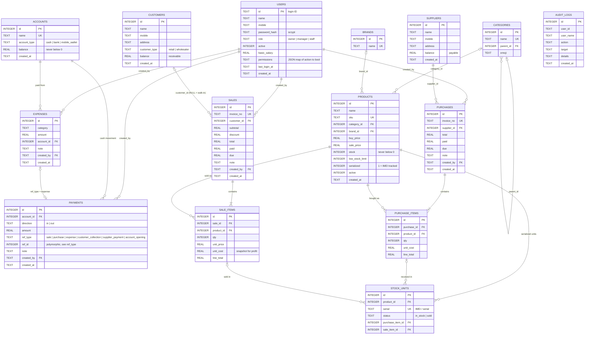

# SA Telecom POS + ERP — Entity Relationship Diagram

Source of truth: [backend/src/schema.sql](../backend/src/schema.sql). This file documents it.

`AUDIT_LOGS` has no foreign key on purpose: it keeps history even if a user is later removed.

## Invariants the code keeps

| Rule | Where enforced |
|------|----------------|
| `products.stock` equals the count of `in_stock` units for serialized products | `routes/sales.js`, `routes/purchases.js` (inside one transaction) |
| A serial is globally unique and can be sold only once while in stock | `stock_units.serial UNIQUE`, checked in sale and purchase routes |
| Walk-in sales (no customer) must be paid in full | `routes/sales.js` |
| An account balance never goes negative | `lib/ledger.js` (`moveMoney`) |
| Every cash movement writes a `payments` row | `lib/ledger.js` |
| `customers.balance` / `suppliers.balance` change only with a sale, purchase, or settlement | `routes/sales.js`, `routes/purchases.js`, `routes/parties.js` |
| All multi-table writes run in one transaction | `lib/db.js` (`tx`) |

## Known gaps versus the legacy app

Not yet modelled: returns, service/repair tickets (`carigor`, service tracker), product variants and custom category fields, wholesalers as a separate type, salary records, WhatsApp templates, money transfers between accounts, and `daily cash` snapshots. See [LEGACY_ANALYSIS.md](LEGACY_ANALYSIS.md).
